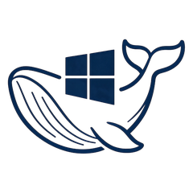
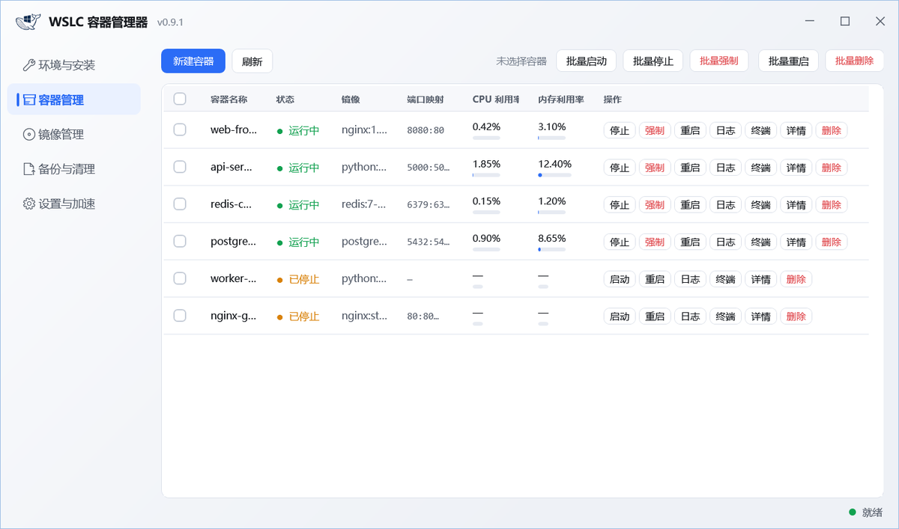

# WSLC 容器管理器（WSLCManager）

<p align="center">
  
</p>

WSL 容器（`wslc`）的可视化管理工具。C# + WPF（net8.0-windows），单文件绿色版。

**下载** → [最新版本 · Releases](https://github.com/cjx2022/WSLCManager/releases/latest)：单文件 exe（约 0.7 MB），双击即用。也可[自行编译](#开发)。

> **非官方工具**：本项目是独立第三方实现，与微软及任何镜像服务商**均无隶属或背书关系**。
> `WSL` / `wslc` 是微软的产品；本工具只是调用它们的命令行接口。



## 这是什么

微软从 **WSL 2.9.3** 起内置了容器能力，命令行工具是 `wslc.exe`，子命令与 Docker CLI 基本对齐
（`wslc run` / `wslc image ls` / `wslc container ps` / `wslc stats` …）。
本工具把这些命令封装成可视化界面，不用记参数也能管容器。

## 功能

| 模块 | 能力 |
|---|---|
| **环境与安装** | 检测 WSL / wslc 环境与版本；**安装**（`wsl --install`）/ 更新稳定版 / 更新预览版；从官方安装包静默安装；跳转 Store / 官方发布页；执行日志 |
| **容器管理** | 列表**恒含已停止容器**（没有开关去切换），**行内直接显示 CPU / 内存利用率与端口映射**；行内操作：启动 / 停止 / 重启 / 日志 / 终端（shell 可选） / 详情 / 删除；**勾选多选 → 批量启动 / 停止 / 重启 / 删除**；可视化新建容器；**单元格右键复制**（容器名称 / 镜像 / 端口映射） |
| **容器详情卡片** | 点「详情」或直接点 CPU / 内存单元格：实时性能（2 秒自刷新）+ 基本信息（含 IP / 网关）+ 配置详情(JSON) / 运行日志 |
| **镜像管理** | **本地索引检索**（见下方说明）+ 本地镜像列表每行带「删除」；拉取（支持自填加速前缀，失败自动回退官方源，**可中途停止**并显示实时速率）；**标注镜像被哪些容器占用** |
| **备份与清理** | 容器 → `tar` 存档（自动先停、完事恢复运行）+ 配置元数据（`inspect` 原文，恢复时**按原配置**重建：启动命令 / 端口映射 / 环境变量）；`tar` → 镜像导入 + 自动重建容器；**重建会话**（只删 `sessions` 子目录，保留同级的 `settings.yaml`）；**压缩虚拟磁盘**（`diskpart compact`，需 UAC，按真实输出判定成败） |
| **设置与加速** | 加速前缀（保存即生效，无需重启）、加速地址连通性实测、镜像索引导入导出、重启应用、打开配置目录 |
| **系统托盘** | 点关闭按钮**最小化到托盘**（不退出），托盘双击恢复，右键菜单可退出 |

### 列表里复制信息（右键）

容器列表的**容器名称 / 镜像 / 端口映射**三列支持右键复制，成功与否走状态栏静默回执：

| 列 | 右键复制到的内容 |
|---|---|
| 容器名称 | `nginx-gateway` |
| 镜像 | `library/nginx:stable` |
| 端口映射 | `80:80,443:443` |

- 复制的是**数据原值**，不是列表里为排版截断过的显示值 —— 上面三例在界面上分别显示为
  `nginx-gate…`、`nginx:stable`、`80:80 等 2 项`，复制一串带省略号的文本没有意义。
- 空值不写剪贴板（例如没有端口映射的行，状态栏提示「这一行没有端口映射可复制」）。
- 剪贴板被别的程序占用时**重试 3 次再报错**，不会静默失败（旧写法 `catch { }` 把异常吞掉，
  用户会以为复制成功了）。
- 其余列（状态 / CPU / 内存 / 操作）没有可复制的语义，右键保持无操作。

### 容器状态语义

| 图标 | 含义 | 判定 |
|---|---|---|
| 🟢 圆点 | 运行中 | JSON 的 `State = running` |
| 🟡 圆点 | 已停止 / 待启动 / 重启中 / 停止中 | `State = exited/created/restarting`，或刚点过停止 |
| 🔴 ⚠ 感叹号 | **异常故障** | 退出码为真正的异常码（如 1 / 2 / 139），或 `State = dead` |

> ⚠ **为什么 `Exited (137)` 不算故障**：实测 `wslc container stop` 正常停止后退出码**也是 137**
> （容器内进程不响应 SIGTERM，被 SIGKILL 强杀），和 `container kill` 完全一样。
> 所以 130(SIGINT) / 137(SIGKILL) / 143(SIGTERM) 一律按「正常停止」处理，只有其它非 0 码才算异常。

### 启动之后为什么可能立刻变成「已停止」

`wslc container start` 返回成功，只代表**启动请求被接受**，不代表容器还在跑 ——
容器在**主进程结束**时就停止，而命令照样返回成功。

本工具不会把这种「指令成功」直接报成「启动成功」：

- 点「启动」/「重启」后会复查真实运行态；
- 指令成功但容器没在跑 → 状态栏报**「容器随即退出（退出码 N）」**（橙色），
  执行输出里给出**当前的启动命令**以及怎么改；
- 复查**问不到**（wslc 不可用 / 输出解析不了）时**放弃判断**，不误报。

最常见的「起完就退」是交互式 shell：`/bin/sh` 没有终端时会立刻读到 EOF 退出。
勾选「分配终端（-i -t）」，或换成不会自己结束的命令（如 `sleep infinity`）即可常驻。

### 停止 vs 强制终止

行内同时提供两个按钮，实测差异很大：

| 操作 | 行为 | 实测耗时 |
|---|---|---|
| **停止** | 发 SIGTERM 等应用退出（`-t 8`，容器不响应才强杀） | 约 8 秒 |
| **强制** | 直接 SIGKILL，不给清理机会 | 约 0.4 秒 |

容器卡死时用「强制」。批量区同样有「批量停止」与「批量强制」。

### 镜像加速前缀

设置页「加速前缀」里填**纯主机名**（可带端口，不要写 `https://`）。留空 = 直连官方源。
「常用镜像源」那一排按钮是给你点着填的预设清单，默认内置下面这批**公开、免注册**的地址：

```
docker.m.daocloud.io     # DaoCloud 公共加速
docker.1ms.run           # 社区公开
hub.rat.dev              # 社区公开
docker.xuanyuan.me       # 社区公开
```

> ⚠ **这些地址与本工具作者无关**：不提供、不运营、不背书。可用性与速度一概不保证，
> 随时可能限流、变更或失效 —— 它们不是本工具的能力，只是替你省下打字。
> **请自行判断风险后再使用**，生产环境建议优先用云厂商的专属加速地址（需注册）。

可自行增删：在 `settings.ini` 里改 `MirrorPresets=`，或点按钮列表下方的输入框手填。

```
RegistryMirror=docker.m.daocloud.io            ← 纯主机名
MirrorPresets=docker.m.daocloud.io,hub.rat.dev ← 逗号分隔；写 none 表示一个都不用
```

> 「检测加速地址可用性」按钮**会真的拉一次 `alpine:latest`** 来验证 ——
> 「首页打得开」只说明 Web 服务在，不代表 registry 端能转发镜像。
> 副作用是测完 `alpine:latest` 会留在本地镜像列表里，不需要可到镜像页删掉。
> 检测范围 = 输入框里当前填写的地址 + `MirrorPresets` 里的全部预设。

#### 官方镜像要补 `library/`

镜像站的首页 / `/v2/` 能连上，**不代表拉取能成**：

- Docker Hub 官方镜像（`alpine` / `nginx` / `redis` …）的**规范全名是 `library/<名>`**。
  `docker pull alpine` 能成功，是因为官方客户端替你补了 `library/`；换成第三方加速前缀后，
  这个 `library/` **要由调用方自己补**。多数镜像站对 `<前缀>/hello-world:latest`（裸名）
  直接返回 `denied`，对 `<前缀>/library/hello-world:latest` 才肯转发。
- 本工具的「检测加速地址可用性」与「拉取镜像」走**同一套拼接规则**，
  不会出现「检测说地址可用、点拉取却报 denied」。

拉取时的候选顺序（只有官方镜像才有多候选）：

```
alpine:latest   →  <前缀>/library/alpine:latest   ← 先试
                →  <前缀>/alpine:latest           ← 少数站点只认裸名
nginx:1.27      →  <前缀>/library/nginx:1.27
jc21/xxx:latest →  <前缀>/jc21/xxx:latest         ← 用户命名空间，不加 library/
<自带的 registry>/a:1 → 原样（已带 registry，不再叠加前缀）
```

设置页的「预览」框会实时显示最终拼出的地址，做到「所见即所执行」。

### 镜像检索说明

**为什么远程检索国内都用不了**：实测 `hub.docker.com` 与 `registry-1.docker.io` 的 DNS
已被污染（解析到的都不是 Docker 的真实地址），连接一律超时；`wslc` 自身也没有
`search` 子命令；各镜像站的 `/v2/` 只返回 401/405（registry 协议本身没有搜索接口）。
**这是网络机制问题，不是命令或用错接口。**

因此工具的做法是：**只用内置索引**，同步瞬时返回（索引 130+ 条，按名称与描述匹配），
并在界面标注数据来源与索引版本。索引是"会过时的数据"，所以可**导出 → 改 → 导入**，
导入后立即生效；也可以「恢复内置索引」。

还找不到就点「**浏览器搜索**」，用系统浏览器打开一个搜索页自行查询
（地址模板可配，默认是 Docker Hub 官方搜索页 —— 若你的网络打不开，改成能用的搜索页即可）。

> 代码里还保留了一份 `SearchRemoteAsync`（限时 3s 的 Docker Hub 检索尝试），
> 但**界面不调用它** —— 在目标网络里那 3 秒等不到任何东西，只会让用户以为界面卡住。
> 它是可选增强，`_probe` 有对应的限时自检；将来做"代理环境下补充真实仓库数据"时可用。

### 窗口外框

顶部那条色带来自 **DWM 绘制的非客户区**。试过三种做法，只有第三种有效：

| 做法 | 结果 |
|---|---|
| 默认 | 顶部一条偏深的色带（约 11 物理像素） |
| `DWMWA_BORDER_COLOR = NONE` | ❌ 变透明，直接透出桌面壁纸，更糟 |
| `DWMWA_CAPTION_COLOR` 涂成背景色 | 变浅但仍然有色差 |
| `NCRENDERING_POLICY = DISABLED` | ❌ 没人绘制这段，PrintWindow 抓到灰色 |
| **`WindowChrome`** | ✅ 整个窗口都是客户区，色带与非客户区彻底消失 |

同时用 `DWMWA_WCP_DONOTROUND` 关掉了 Win11 默认圆角（四角露出桌面看起来像"缺角"）。

### 容器网络

本工具**不提供网络设置**：实测 wslc 的 `run --network` 可选项形同虚设 ——
`bridge` 是默认值、`host` 直接报「不支持主机模式网络」（exit=1）、`none` 基本用不上，
网段也无法自定义。摆一个改不动、也选不出有效项的下拉没有意义，故整块移除。

容器所属网络、IP、网关与端口可在「详情」卡片中查看。网络名 / IP / 网关取自
`wslc inspect`（`wslc ps` 在未映射端口时端口列是空的，看不出地址），只读展示。
若确需操作网络，直接用 `wslc network` 子命令
（`create / remove / inspect / list / prune / connect / disconnect`），或编辑
`%LOCALAPPDATA%\wslc\settings.yaml`；WSL 层面的网络模式（NAT / mirrored）在用户目录的
`.wslconfig` 里用 `[wsl2] networkingMode` 配置。

> 注：wslc 的镜像和容器**都存在虚拟磁盘里**（`%LOCALAPPDATA%\wslc\sessions\<会话>\storage.vhdx`），
> 没有单个镜像文件，所以镜像列表不提供「打开目录」。

### 容器 IP 怎么看

**IP 不在容器列表里，只在「详情」卡片里** —— 这是刻意的：列表的「端口」列取自 `wslc ps`，
未做端口映射时它是空的，单看列表会以为容器「没有地址」，其实 IP 一直存在。
详情卡片用 `wslc inspect` 把它拆成三行显示：`IP 地址` / `网关` / `网络`。

> 取 IP 用的是 `wslc inspect -f json`。**`-f` 只认 `json`，不支持 Go 模板**
> （传 `{{.NetworkSettings.IPAddress}}` 会报「不是可识别的格式类型」，2026-10 实测）。

### 端口映射（-p）是否必填

**不是必填，但「要从 Windows 访问容器里的服务」时必填。** 实测（2026-10，WSL 3.0.1.0）：

| 场景 | 不填 `-p` | 填 `-p 18080:80` |
|---|---|---|
| 容器内网 IP | 有（`172.17.0.x/16`） | 有 |
| 容器主动出网 | ✅ 可以（实测 wget 通） | ✅ |
| Windows 访问容器服务 | ❌ 内网 IP 不可直达（实测 5 s 超时） | ✅ `http://127.0.0.1:18080` 返回 200 |
| `wslc ps` 端口列 | 空 | `127.0.0.1:18080->80/tcp` |

所以「不填端口就没 IP」是误解：**IP 一直有**，只是那是 WSL 内的私有地址，Windows 侧访问不到；
而未发布端口时列表里的「端口」列是空的，看起来才像「没有地址」。
只做出网客户端（拉数据、跑任务）可以不填；要对外提供服务就必填。

### 删除镜像的语义：可能只摘掉标签

`wslc image rm` 删除**被容器引用**的镜像时**不报错**：

| 情形 | 输出 | 真实结果 |
|---|---|---|
| 没有容器引用 | `已取消标记: …` + `已删除: sha256:…` | ✅ 镜像层删除，空间回收 |
| **有容器引用（运行中或已停止）** | 只有两行 `已取消标记: …`，exit=0 | ⚠ 只摘标签；**镜像层不删、空间不释放**，镜像从列表消失（看着像成功了） |

所以镜像列表有一列「**占用**」把这件事标出来（被谁占用、运行中还是已停止），
悬停有完整解释。要真正回收空间，先把引用它的容器删掉。

### 打开终端（shell 可选）

行内「终端」按钮**不把命令写死成 `sh`**：容器里是 bash 还是 sh、或者干脆没有 shell，
完全由镜像决定（alpine 只有 busybox 的 `sh`，debian / nginx 才有 `bash` + `dash`），
写死一种必然在某些镜像上开出一个报错的窗口。

点「终端」会先弹一个选择框：

1. 打开时用 `wslc exec <容器> sh -c 'for s in bash sh ash zsh dash fish busybox; …'`
   **实时探测**容器内可用的 shell，按 `bash → sh → ash → zsh → dash → fish → busybox` 优先级列出；
2. 默认选中 `bash`（没有 bash 就退到 `sh`）；
3. 选「自定义…」可手填任意命令（例如 `sh`、`ash`、`/bin/bash -l`），探测不到也能用；
4. 对话框里实时显示将执行的完整命令。

启动优先用 Windows Terminal（`wt.exe`），未安装时回退到 `powershell.exe -NoExit`，
两者都不可用才报错。容器未运行时按钮为禁用态（`wslc exec` 只能在运行中的容器里用）。

> 探测判据是「输出里有没有候选 shell」，**不能要求退出码为 0** ——
> 循环体是 `command -v $s && echo $s`，最后一个候选不存在时整条命令退出码就是 1，
> 但输出完全正常（这里踩过一个假失败）。

## 许可与开源

MIT License，著作权归 **billchen**（见 [LICENSE](LICENSE)）。

| 项 | 说明 |
|---|---|
| 许可 | MIT，可自由使用 / 修改 / 再分发（保留版权声明即可） |
| 第三方代码依赖 | 仅 `System.Text.Encoding.CodePages`（MIT） —— 用于 GBK 解码回退 |
| 字体 | **不打包任何字体文件**，只按名字引用 Windows 自带字体（见下） |
| 品牌图形 | **logo 由作者设计**（深蓝配色，容器 / 鲸鱼意象，呼应 WSL 形象）。`_tools/make_logo.py` 从原始素材派生 README 图、标题栏图与多尺寸 `app.ico`，脚本自包含、可复现 |
| 与厂商的关系 | 不隶属、不背书任何镜像服务商；著作权信息只写作者个人。设置里预置的加速地址是第三方**公开**站点，随时可能失效，使用风险自负 |

### 字体

界面只**按名字引用** Windows 自带字体，**仓库与产物里都没有 `.ttf/.otf`**：

| 用途 | 字体 | 许可 |
|---|---|---|
| 界面正文 | `Microsoft YaHei UI`（微软雅黑 UI） | Windows 自带，微软专有 |
| 代码 / 日志 | `Consolas` | Windows 自带，微软专有 |
| 界面图标（标题栏按钮 / 左侧导航） | `Segoe MDL2 Assets` | Windows 自带，微软专有 |

**只写字体名、字形由系统提供，不构成「字体再分发」**，所以开源发布不受影响；
而本程序本身是 Windows-only（`net8.0-windows` + WPF），依赖这些系统字体也不影响可用性。
唯一红线：**不要把字体文件打进仓库或安装包** —— 若将来要内嵌字体（为了跨平台或锁字形），
必须换成开源授权字体（思源黑体 Source Han Sans / Noto Sans CJK、JetBrains Mono 等）。

## 界面结构

```
标题栏（logo + 版本 + 最小化/最大化/关闭）
├ 左侧导航：环境与安装 / 容器管理 / 镜像管理 / 设置与加速   ← 每项带图标
└ 内容区（表格列固定，不可拖动 / 排序 / 改宽）
右下角：环境状态指示
```

## 依赖与兼容性

### 运行依赖

| 依赖 | 要求 | 说明 |
|---|---|---|
| 操作系统 | **Windows 10 2004（Build 19041）及以上 / Windows 11** | WSL 2 的系统下限；更低版本无法运行 `wslc` |
| 架构 | **x64** | 项目固定 `PlatformTarget=x64`，暂无 ARM64 构建 |
| **WSL** | **2.9.3 或更高** | `wslc.exe` 自 WSL 2.9.3 起随包提供；低于此版本工具会提示升级 |
| .NET 运行时 | **.NET 8 Desktop Runtime**（框架依赖版）<br>或 **无**（自包含版） | 见下方「两种发布方式」 |
| Docker | **不需要** | 直接用 WSL 自带容器能力，与 Docker / Docker Desktop 无关 |

> 工具**自身不联网**，只在你主动拉取镜像时才产生网络请求；不填加速前缀也能正常使用
> （管理本地已有容器 / 镜像不需要网络）。

### 两种发布方式

| | 框架依赖版（默认） | 自包含版 |
|---|---|---|
| 体积 | 约 **0.7 MB** | 约 68 MB |
| 是否需要 .NET 8 | **需要** | 不需要 |
| 适用场景 | 本机已装 .NET 8 桌面运行时 | 干净机器 / 直接拷给别人 |

发布命令见「开发」章节。

### NuGet 依赖

只有 1 个，且是微软官方包：

| 包 | 版本 | 许可 | 用途 |
|---|---|---|---|
| `System.Text.Encoding.CodePages` | 8.0.0 | MIT | 命令行输出回退 GBK 解码（`wsl` / `wslc` 的中文输出） |

**没有其他第三方库** —— 界面、图标、托盘全部用 WPF / WinForms 内置能力实现。

### 系统字体（不打包，只按名字引用）

| 用途 | 字体 | 来源 |
|---|---|---|
| 界面正文 | Microsoft YaHei UI（微软雅黑 UI） | Windows 自带 |
| 代码 / 日志 / 进度 | Consolas | Windows 自带 |
| 图标（窗口按钮 / 左侧导航） | Segoe MDL2 Assets | Windows 自带 |

**三者均为 Windows 自带字体，仓库与产物中不含任何 `.ttf` / `.otf`**，因此不构成字体再分发。
若将来要内嵌字体以锁定字形，必须换成开源授权字体（思源黑体 / Noto Sans CJK / JetBrains Mono）。

### 兼容性矩阵（实测）

| 项 | 值 |
|---|---|
| WSL / wslc | **3.0.1.0** —— 开发与验证基准 |
| 最低 WSL | **2.9.3**（`wslc` 命令的起点） |
| .NET SDK（仅编译需要） | 8.0 即可（项目 `LangVersion=12.0`） |
| Windows | **Windows 11**（主测环境）；Windows 10 2004+ 理论上可用但未实测 |
| 高 DPI | 支持 **PerMonitorV2**（在 `app.manifest` 声明，非整数缩放下文字不糊） |
| 运行权限 | 普通用户即可；仅「从官方安装包安装 WSL」一步需要提权 |

### 已知限制

- **x64 only**：暂无 ARM64 构建。
- **Windows only**：`net8.0-windows` + WPF，不做跨平台。
- **不代管网络**：安装 WSL / 拉取镜像若遇网络问题需自行解决出口。工具只提供**自填**加速前缀，
  且该前缀**只作用于 `wslc pull`**，不会写进任何安装流程。
- **受 `wslc` 能力边界约束**：例如 `wslc` 未提供 `pause` / `unpause` 子命令，工具也就没有这两个操作；
  `wslc stats` 本身是快照语义，没有 `--no-stream`。
- **托盘图标依赖 WinForms**（WPF 无内置托盘 API），故 `UseWindowsForms=true`。

### 关于安装 WSL 的说明

工具内所有安装动作**只走微软官方渠道**，不预置任何第三方安装源：

1. `wsl --update`：官方自更新（推荐）
2. `wsl --update --pre-release`：官方预览通道
3. 菜单「从官方安装包安装」：自行从微软官方渠道取得 `.msi`/`.msix` 后交给工具静默安装
4. 「打开 Microsoft Store」：商店版 WSL 由商店负责升级

> 若所处网络访问官方源困难，请自行解决网络出口（这是环境问题，工具不代劳），
> 或在设置页填写**你自己的**镜像加速前缀——该前缀只作用于 `wslc pull`，不会写进任何安装流程。

## 开发

```bash
# 编译
dotnet build -c Release

# 服务层探针（不需要界面，直接验证 CLI 解析）—— 21 节自检
dotnet run --project _probe

# 发布单文件（框架依赖，约 0.7MB）
dotnet publish -c Release -r win-x64 \
  -p:PublishSingleFile=true -p:PublishSelfContained=false -p:EnableCompressionInSingleFile=false

# 重新生成 logo 与应用图标（自包含脚本，可复现）
python _tools/make_logo.py
```

### 目录结构

```
WSLCManager/
├── Models/        ContainerInfo / ImageInfo / ImageUsage / ContainerStats / ContainerSpec
├── Services/      ProcRunner（进程封装 + 自适应解码）/ TableParser（表格与 NDJSON 解析）
│                  WslcService（业务）/ InstallService（环境安装检测）
│                  RestorePlanner（备份元数据 → 容器规格，纯函数，探针可直接喂真实 JSON 断言）
│                  ImageSearchService（本地索引检索）/ DownloadProbe（wsl --update 进度旁路）
├── Helpers/       ChromeHelper（无边框窗口）/ AppSettings / TextQuality（DPI 自适应排版）
│                  DiskCompactor（diskpart compact + 真假成功判定）/ NetMeter（拉取速率采样）
│                  MemoryTrimmer / Converters / TrayIcon / NativeMethods
├── Dialogs/       AppDialog / CreateContainerDialog / ContainerDetailDialog
│                  ContainerLogsDialog / TerminalDialog
├── Themes/        Styles.xaml
├── Assets/        logo.png（应用内 logo）
├── _probe/        服务层探针控制台（21 节自检，直接复用主项目源码）
├── _tools/        make_logo.py（品牌图形生成）/ screengrab.py（真实屏幕抓取，验收用）
├── LICENSE        MIT
└── app.ico / app.manifest
```

### 调试参数

```
WSLCManager.exe --page=env|container|image|backup|settings 直接打开指定页
WSLCManager.exe --size=WxH                            指定窗口尺寸（含最小宽度下的表现）
WSLCManager.exe --search=关键字                       启动即检索一次（验收用）
WSLCManager.exe --dialog=create|detail|logs|terminal|confirm|info  直接打开对应对话框
WSLCManager.exe --pick-custom                         配合 --dialog=terminal：切到「自定义命令」分支
WSLCManager.exe --demo                                清掉真实数据换成纯演示数据（对外截图/文档配图用）
WSLCManager.exe --fill-demo                           往镜像页两个输入框填长演示文本（核对排版）
WSLCManager.exe --stress=N                            灌 N 行假数据把列表撑出滚动条（纯内存）
WSLCManager.exe --screenshot=<路径> [--exit-after-shot]  把窗口渲染成 PNG 后退出
WSLCManager.exe --dump-layout=<路径> [--exit-after-shot] 导出关键控件的真实布局矩形（文本）
WSLCManager.exe --click-start=<容器名> [--dump-ui=<路径>] 在真实界面上点一次该行的「启动」，导出界面文案
WSLCManager.exe --right-copy=<容器名> [--dump-ui=<路径>] 对该行三列各发一次真实右键，断言剪贴板内容与状态栏
WSLCManager.exe --grab                                配合 --screenshot：连 DWM 非客户区一起抓
WSLCManager.exe --software                            强制软件渲染（低配/远程桌面场景）
WSLCManager.exe --textmode=display|ideal              强制指定文字排版模式（排查字体发虚用）
```

> `--dump-layout` / `--screenshot` 这类验收参数一律配 `--exit-after-shot` 才能自动退出。
>
> `--click-start` / `--right-copy` 走的是**真实 UI 路径**（在视觉树里定位该行的按钮 / 单元格并触发，
> 与用户手点同一条代码路径），导出状态栏文本 / 状态圆点色 / 执行输出 / 列表状态。
> 需要「文案对不对」这类结论时用它 —— 只调服务层证明不了界面。

## 常见问题

- **文字发虚** → 默认走**硬件渲染**（软件渲染下 ClearType 会退化成灰度抗锯齿，中文小字明显发虚），
  且排版模式按显示器 DPI 自适应（≈100% 用 `Display`、>100% 用 `Ideal`）。
  若手工把 `RenderMode` 改成过 `Software`，把它改回 `Hardware`。
- **容器列表里 CPU / 内存一直显示「—」** → 只有**运行中**的容器才有性能数据。
- **容器状态为什么是红色感叹号** → 表示异常退出（退出码非 0，例如被 kill 的 137）；
  `Exited (0)` 是正常停止，显示黄色。
- **删了镜像但磁盘空间没回来** → 该镜像还被容器引用，wslc 只摘标签不删层（见上文「镜像删除」节）。
- **`wsl --update` / `--pre-release` 卡住不动** → 官方通道在国内网络下可能走不通；
  可改用「从官方安装包安装」，自行下载官方 `.msi` 后交给工具静默安装。
- **换了图标但资源管理器里没变** → Windows 图标缓存问题，执行 `ie4uinit.exe -show` 或重启资源管理器。
- **关不掉程序** → 点关闭是**最小化到托盘**；要退出请右键托盘图标选「退出」。

## 后续规划

- 容器编排（多容器一键起停、compose 风格描述文件）
- 镜像构建（`wslc build`）可视化
- 容器资源限制（CPU / 内存配额）配置项

## 更新日志

### v0.9.1（2026-10-12）

- **新功能**：容器列表**单元格右键复制** —— 容器名称 / 镜像 / 端口映射，复制的是全量值。
- **修复**：按原配置恢复容器时**端口映射不再丢失**（此前恢复出的容器会丢掉 `-p` 映射）。
- **修复**：压缩虚拟磁盘的**成败判定**不再误报成功。
- **修复**：备份导出失败时，被停下的容器会明确提示当前状态与恢复方式。
- **修复**：以 `--demo` 启动演示模式时，列表不再被后台刷新清空。
- **改进**：容器列表**恒含已停止容器**，「显示已停止」勾选框已移除。
- **改进**：「重建会话」只清空容器与镜像，不再动 wslc 的全局设置；确认框写明实际删除的目录。

### v0.9.0（2026-10-10）

首个公开版本：环境与安装 / 容器管理 / 镜像管理 / 容器详情 / 内置终端 / 系统托盘 / PerMonitorV2 高 DPI。
